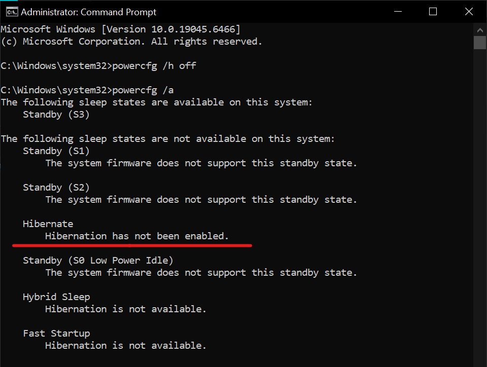
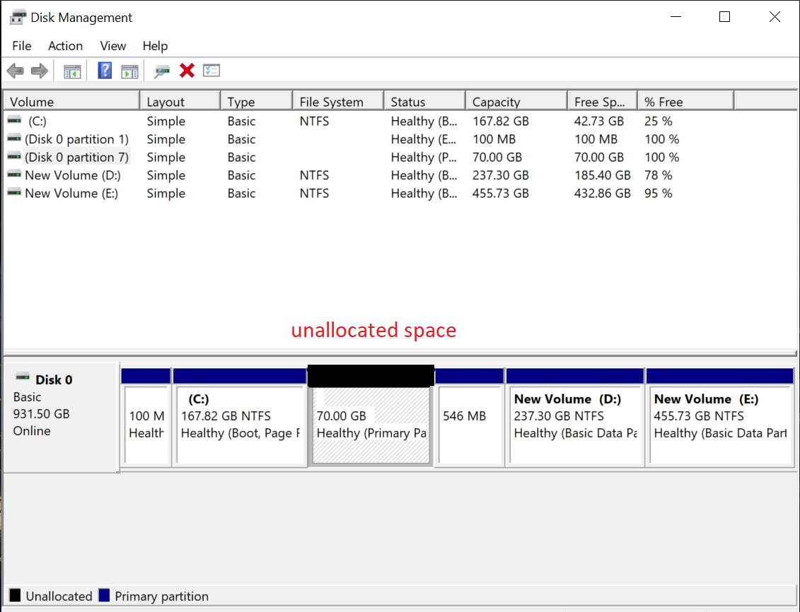
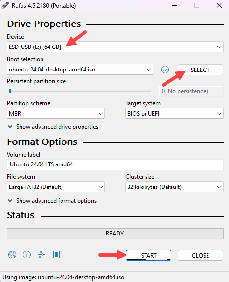
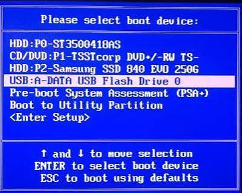
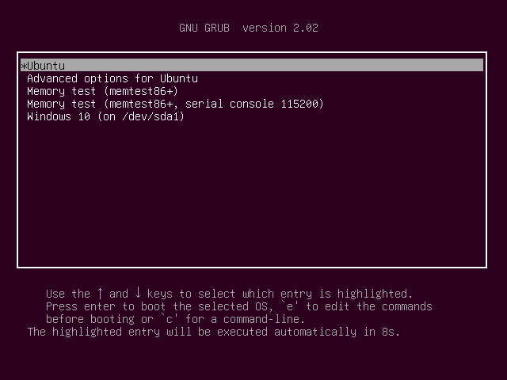
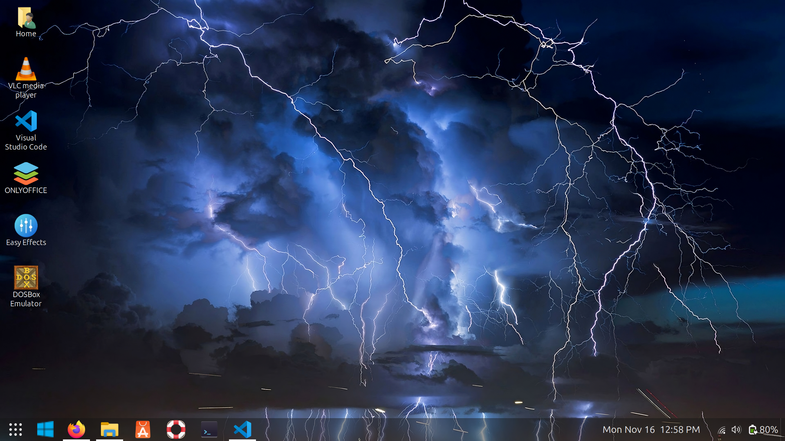
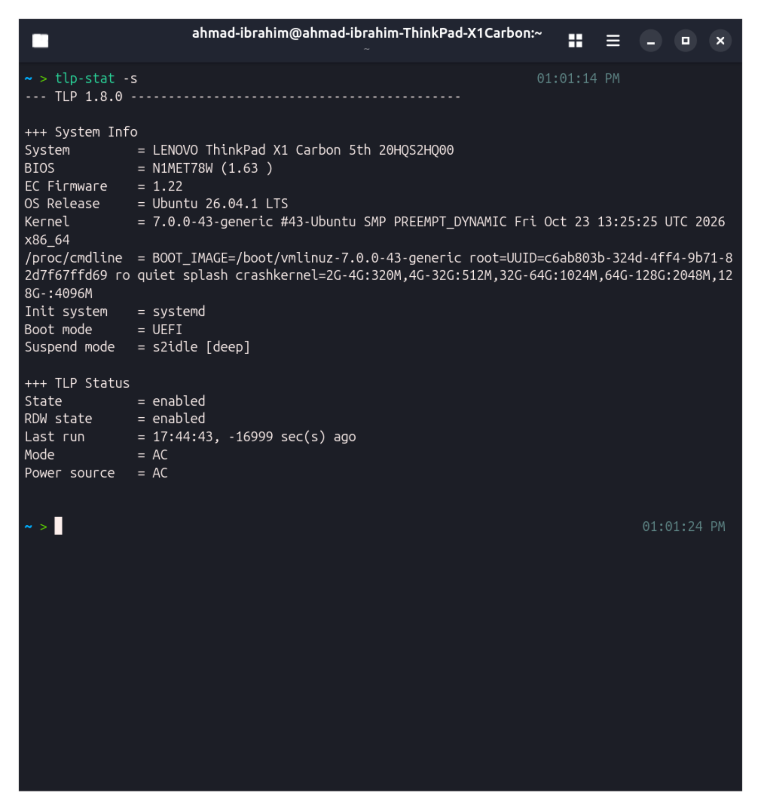
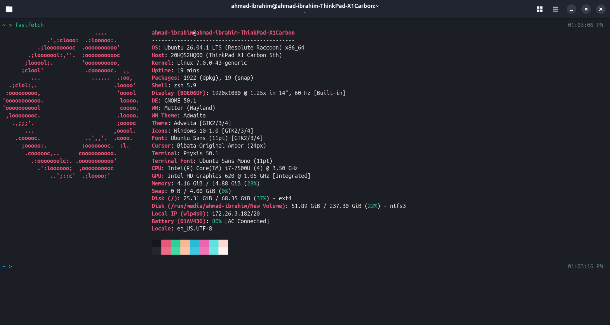

+++
date = '2026-11-16T10:30:00+05:00'
draft = false
title = 'Dual Booting Ubuntu 26.04 LTS'
description = 'A step-by-step guide to dual booting Ubuntu alongside Windows, plus how I set up and customised it afterwards.'
summary = 'A step-by-step guide to dual booting Ubuntu alongside Windows, plus how I set up and customised it afterwards.'
tags = ['linux', 'ubuntu', 'dual-boot', 'windows', 'thinkpad']
+++

I had been thinking about moving from Windows to Linux for a long time, but I never had the confidence to do it. Part of the reason was simple: I love Windows. It has been my OS since childhood.

But my field keeps moving toward Linux, and many of my friends had already made the switch. I felt like I was falling behind. So after some deep thinking, I decided to dual boot **Ubuntu 26.04 LTS** next to **Windows 10** on my **ThinkPad X1 Carbon**.

Dual booting means both systems live on the same laptop, and you choose which one to start each time you power on. Windows stays untouched as a safety net while you learn Linux.

This post walks through exactly how I did it, then covers how I customised Ubuntu afterwards. I tried to keep every step simple.

## What you need

- A laptop with at least **60 GB of free space** (more is better; I would not go below 50 GB)
- A **USB drive of 8 GB or more** (it will be erased)
- The **Ubuntu 26.04 LTS ISO**, downloaded from [ubuntu.com/download](https://ubuntu.com/download/desktop)
- A tool to write the ISO to the USB: [Rufus](https://rufus.ie) on Windows, or [Balena Etcher](https://etcher.balena.io)
- About 1 to 2 hours and a stable power connection (plug in your charger)

## Step 0: Before you touch anything

These checks prevent most of the problems people run into.

1. **Back up your important files.** Partitioning is safe when done correctly, but a mistake or a power cut can cost you your data. Copy what matters to an external drive or cloud storage.
2. **Check whether BitLocker is on.** If your Windows drive is encrypted, find your recovery key first (Microsoft account, then Devices), because changing the boot setup can trigger a recovery prompt.
3. **Turn off Fast Startup.** Go to Control Panel, then Power Options, then “Choose what the power buttons do”, then “Change settings that are currently unavailable”, and untick **Turn on fast startup**. If you don’t see that option, hibernation is already off and you’re fine. You can also disable both at once by running **powercfg /h off** in an administrator Command Prompt.

📸 *Screenshot: disabling hibernation using cmd*



## Step 1: Make free space for Ubuntu

Ubuntu needs its own space on the disk. We will shrink the Windows partition to create it.

1. Press `Win + X` and open **Disk Management**.
2. Right-click your main Windows partition (usually the **C:** drive) and choose **Shrink Volume**.
3. Enter the amount to shrink in MB. For example, **61440 MB** gives you about 60 GB.
4. Click **Shrink**. You will now see a block of **Unallocated** space.

Leave that space unallocated. Do not format it and do not create a new volume in it. The Ubuntu installer will use it.

📸 *Screenshot: Disk Management showing the unallocated space*



## Step 2: Create the bootable USB

1. Plug in your USB drive.
2. Open Rufus, select the USB drive, and click **SELECT** to choose the Ubuntu ISO.
3. Leave the defaults (GPT partition scheme for UEFI systems) and click **START**.
4. If Rufus asks, choose **Write in ISO Image mode**, then confirm. Wait for it to finish.

📸 *Screenshot: Rufus with the ISO selected*



## Step 3: Boot from the USB

1. Restart the laptop.
2. As soon as the ThinkPad logo appears, press **F12** to open the one-time boot menu. (To enter the BIOS settings instead, press **F1**.)
3. Choose your USB drive from the list.

If the USB does not appear, open the BIOS (**F1**) and check that **Secure Boot** and the boot order are not blocking it. Ubuntu supports Secure Boot, so you usually do not need to turn it off, but if the USB still refuses to boot, disabling it temporarily is the common fix.

📸 *Photo: the F12 boot menu*



At the GRUB menu that follows, select **Try or Install Ubuntu**.

## Step 4: Install Ubuntu alongside Windows

The installer boots into a live session first, which lets you test Ubuntu without installing anything. When you are ready, start the installer and go through the screens:

1. **Language and keyboard layout:** pick yours.
2. **Network:** connect to Wi-Fi. This lets the installer download updates.
3. **Installation type:** choose the **interactive installation**, and select the default apps.
4. **Install third-party software:** I recommend ticking the option for graphics, Wi-Fi hardware, and media codecs. It saves a lot of trouble later.
5. **Disk setup (the important step):** choose **Install Ubuntu alongside Windows Boot Manager**. This is the safest option because the installer uses only the free space you created and leaves Windows alone. 
6. **Create your account:** set your name, computer name, username, and a strong password.
7. **Timezone:** confirm it.
8. **Review and install.** Check the summary, then click **Install**.

When it finishes, click **Restart now**, and remove the USB when asked.

## Step 5: First boot and the GRUB menu

After the restart, you will see the **GRUB boot menu**. This is where you choose between:

- **Ubuntu**
- **Windows Boot Manager**

Use the arrow keys and `Enter`. If you do nothing, it starts Ubuntu after a few seconds. Choose Windows once to confirm that it still boots normally. Mine did, with everything intact.

📸 *Photo: the GRUB menu on the real laptop*



Congratulations, you are now dual booting.

## First things to do after installing

Open a terminal (`Ctrl + Alt + T`) and update everything:

```bash
sudo apt update && sudo apt upgrade -y
```

Reboot once afterwards if it upgraded the kernel.

## Problems to watch for

<!-- TODO: replace this section with the real problems you hit. Even small ones help readers. -->

- **USB not showing in the boot menu:** recheck the boot order and Secure Boot in the BIOS, and make sure the USB was written in the right mode.
- **Windows asking for a BitLocker recovery key:** this is why you should find the key beforehand.
- **Clock is wrong in Windows after using Linux:** Linux and Windows store time differently. Fix it in Ubuntu with:

```bash
timedatectl set-local-rtc 1 --adjust-system-clock
```

## Additional customisation of Ubuntu

Once everything was installed, I wanted Ubuntu to feel like home, and to run well on a laptop. Here is what I did.

### 1. Make GNOME look like Windows 10

Since I love Windows, I styled the GNOME desktop to look as familiar as possible. I used **GNOME Tweaks**, icon themes, and **GNOME extensions** to get a Windows-style taskbar and a cleaner, more familiar look.

```bash
sudo apt install gnome-tweaks gnome-shell-extension-manager
```

📸 *Screenshot: the final desktop after customising*



### 2. Better battery life with TLP

TLP manages power settings automatically: CPU frequency scaling, USB autosuspend, Wi-Fi power saving, and separate profiles for AC and battery.

```bash
sudo apt install tlp tlp-rdw
```

Ubuntu ships with `power-profiles-daemon`, which conflicts with TLP, so disable it:

```bash
sudo systemctl mask power-profiles-daemon
sudo systemctl enable --now tlp
```

**Protect the battery with a charge limit.** ThinkPads support charge thresholds. Open the TLP config:

```bash
sudo nano /etc/tlp.conf
```

Find and set these lines (remove the `#` at the start if they are commented out):

```
START_CHARGE_THRESH_BAT0=75
STOP_CHARGE_THRESH_BAT0=90
```

I stop charging at 90% to protect the long-term health of the battery. Save with `Ctrl + O`, `Enter`, then exit with `Ctrl + X`, and apply the settings:

```bash
sudo tlp start
```

Check that everything works:

```bash
sudo tlp-stat -s
sudo tlp-stat -b
```

`tlp-stat -s` shows TLP is active, and `tlp-stat -b` shows the battery thresholds.

📸 *Screenshot: tlp-stat output*



### 3. Turn on the firewall

Ubuntu includes a firewall, but it is off by default. GUFW is a friendly interface for it.

```bash
sudo apt install gufw
```

Open GUFW from the app menu and switch the **Status** toggle to **on**. The default rules (deny incoming, allow outgoing) are fine for most people.

### 4. Clean up and keep it light

Remove packages that are no longer needed, including old kernels:

```bash
sudo apt autoremove --purge -y
sudo apt clean
```

### 5. Boost the volume past 100%

The default audio cap was too quiet for me. This setting lifts it:

```bash
gsettings set org.gnome.desktop.sound allow-volume-above-100-percent true
```

### 6. A terminal that looks next-level

This was the most satisfying part. I replaced the plain terminal with **Zsh**, **Oh My Zsh**, and the **Powerlevel10k** theme, plus autosuggestions and syntax highlighting.

**Install Zsh and make it your default shell:**

```bash
sudo apt install zsh git curl -y
chsh -s $(which zsh)
```

Log out and back in for the change to apply.

**Install Oh My Zsh:**

```bash
sh -c "$(curl -fsSL https://raw.githubusercontent.com/ohmyzsh/ohmyzsh/master/tools/install.sh)"
```

**Install Powerlevel10k:**

```bash
git clone --depth=1 https://github.com/romkatv/powerlevel10k.git ${ZSH_CUSTOM:-$HOME/.oh-my-zsh/custom}/themes/powerlevel10k
```

Then open `~/.zshrc` and change the theme line to:

```
ZSH_THEME="powerlevel10k/powerlevel10k"
```

Powerlevel10k looks best with its recommended font. Install **MesloLGS NF** (the Powerlevel10k project provides download links on its GitHub page) and select it in your terminal's preferences. When you open a new terminal, a setup wizard asks a few questions to style your prompt.

**Add autosuggestions and syntax highlighting:**

```bash
git clone https://github.com/zsh-users/zsh-autosuggestions ${ZSH_CUSTOM:-~/.oh-my-zsh/custom}/plugins/zsh-autosuggestions
git clone https://github.com/zsh-users/zsh-syntax-highlighting.git ${ZSH_CUSTOM:-~/.oh-my-zsh/custom}/plugins/zsh-syntax-highlighting
```

In `~/.zshrc`, update the plugins line:

```
plugins=(git zsh-autosuggestions zsh-syntax-highlighting)
```

Reload the config:

```bash
source ~/.zshrc
```

📸 *Screenshot: the terminal with Powerlevel10k*



## What's next

I am still exploring. **Conky widgets** and a proper theme pack are next on my list.

Honestly, this whole process taught me more about Linux than any tutorial could have. If you are thinking about making the switch and feel nervous like I did, dual booting is the safest way to start. Windows stays there if you need it, and you get to learn at your own pace.

If you get stuck on any step, reach out to me on [LinkedIn](https://www.linkedin.com/in/ahmad-ibrahim-360a7a28b).