+++
date = '2026-11-18T11:00:00+05:00'
draft = false
title = 'Building a Blog site with Hugo and PaperMod'
description = 'A beginner-friendly, step-by-step guide to setting up a Hugo site with the PaperMod theme, writing your first post, and customising the look.'
summary = 'A beginner-friendly, step-by-step guide to setting up a Hugo site with the PaperMod theme, writing your first post, and customising the look.'
tags = ['hugo', 'papermod', 'blogging', 'github-pages', 'web']
ShowToc = true
TocOpen = false

[cover]
  image = "hugo.jpeg"
  alt = "hugo logo"
  relative = true
  hiddenInSingle = true
+++

This website is built with **Hugo** and the **PaperMod** theme. When I started, I had almost no idea how it worked. I let an AI scaffold the first version, then spent a few days learning what every folder and file actually does. This post is the guide I wish I had on day one.

By the end you will have:

- A working Hugo site running on your computer
- The PaperMod theme installed correctly
- Your first blog post written and visible
- A customised look (colours, home page, menu)
- A clear idea of how to put it online

📸 *Screenshot: the finished site on the home page*

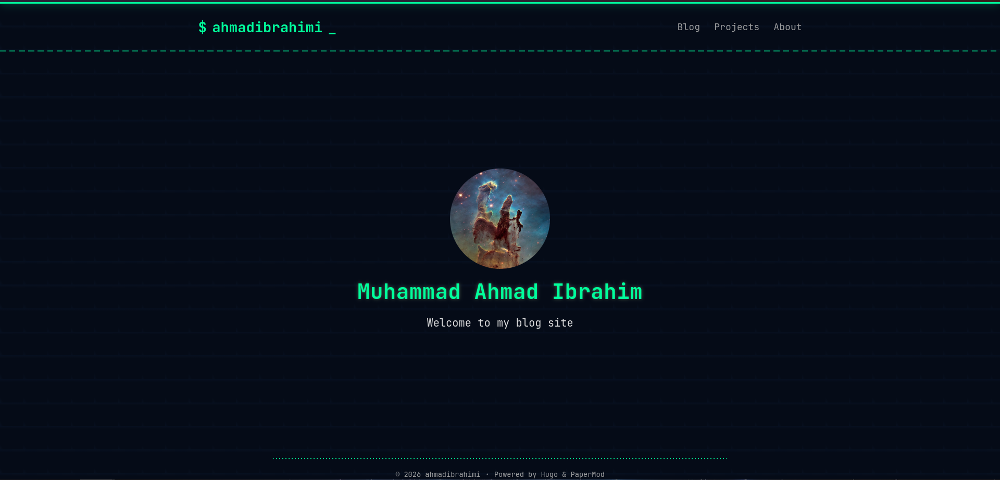

## What is Hugo, and why PaperMod?

**Hugo** is a static site generator. You write your content in simple text files (Markdown), and Hugo turns them into plain HTML pages. There is no database and no server-side code, so the result is very fast and can be hosted for free on GitHub Pages.

**PaperMod** is a popular Hugo theme. It is clean, fast, has a built-in dark mode, and has many options you can switch on with a single line in a config file. It is also easy to customise without touching the theme itself, which is what we will do.

## What you need

- A computer with a terminal (Linux, macOS, or Windows)
- **Git** installed (`git --version` should print a version number)
- A text editor, such as VS Code
- About 30 minutes

## Step 1: Install Hugo

**Ubuntu / Debian:** the version in `apt` is often too old for modern themes, so I recommend downloading the latest **extended** `.deb` file from the [Hugo releases page](https://github.com/gohugoio/hugo/releases) (the file is named like `hugo_extended_X.Y.Z_linux-amd64.deb`), then installing it:

```bash
sudo dpkg -i hugo_extended_*_linux-amd64.deb
```

**macOS:**

```bash
brew install hugo
```

**Windows:**

```bash
winget install Hugo.Hugo.Extended
```

Check that it worked:

```bash
hugo version
```

You should see a version number with the word `extended` in it. If the command is not found, close and reopen your terminal.

📸 *Screenshot: the output of hugo version in the terminal*

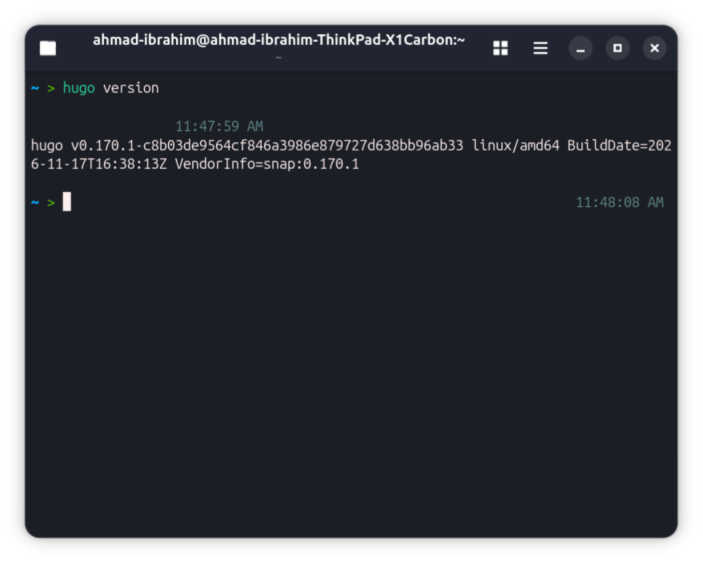

> Always use the latest version when following a theme's instructions. Most "it doesn't work" problems with Hugo themes come from an old Hugo.

## Step 2: Create a new site

```bash
hugo new site my-blog
cd my-blog
```

Hugo creates a folder with this structure:

```
my-blog/
├── archetypes/    templates for new content
├── assets/        CSS and other files Hugo processes
├── content/       your pages and posts (empty for now)
├── data/          data files
├── i18n/          translations
├── layouts/       your own templates
├── static/        files copied to the site as they are
├── themes/        where the theme goes
└── hugo.toml      the main settings file
```

The two folders you will use the most are `content/` (your writing) and `hugo.toml` (your settings).

📸 *Screenshot: the new site's folders open in VS Code*

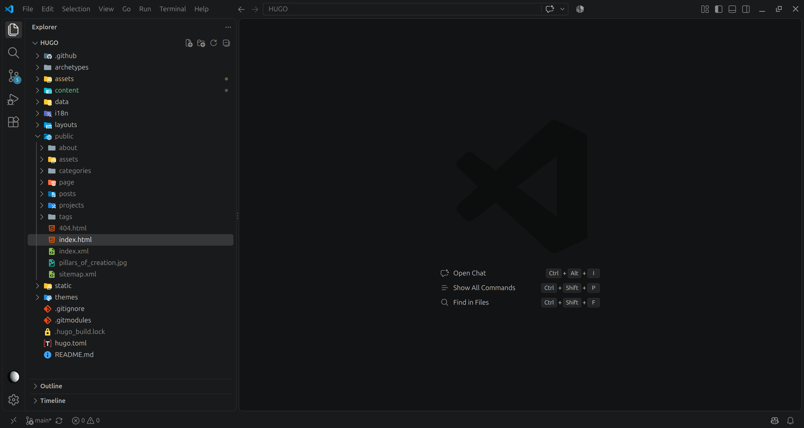

## Step 3: Install the PaperMod theme

Inside the `my-blog` folder, turn it into a Git repository and add PaperMod as a **submodule**. A submodule means Git links to the theme's repository instead of copying all its files into yours, which makes updates easy.

```bash
git init
git submodule add --depth=1 https://github.com/adityatelange/hugo-PaperMod.git themes/PaperMod
git submodule update --init --recursive
```

Now tell Hugo to use it. Open `hugo.toml` and replace its contents with:

```toml
baseURL = "https://YOUR-USERNAME.github.io/"
languageCode = "en-us"
title = "My Blog"
theme = "PaperMod"
```

The name in `theme = "PaperMod"` must match the folder name inside `themes/` exactly, including the capital letters.

📸 *Screenshot: the themes folder showing PaperMod, and hugo.toml with the theme line*

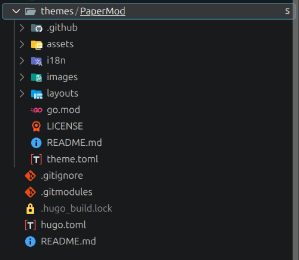

## Step 4: Configure the site

Below those lines, add the basics. In TOML, every `[section]` header owns the lines after it, so keep the plain settings at the top:

```toml
baseURL = "https://YOUR-USERNAME.github.io/"
languageCode = "en-us"
title = "My Blog"
theme = "PaperMod"

[params]
  defaultTheme = "dark"
  ShowReadingTime = true

[menu]
  [[menu.main]]
    name = "Blog"
    url = "/posts/"
    weight = 1
  [[menu.main]]
    name = "About"
    url = "/about/"
    weight = 2
```

What these do:

- `defaultTheme = "dark"` starts the site in dark mode.
- `ShowReadingTime = true` shows "5 min" on each post.
- `[[menu.main]]` (with double brackets) adds one item to the top menu. The `weight` sets the order, and lower numbers come first.

📸 *Screenshot: the finished hugo.toml in VS Code*

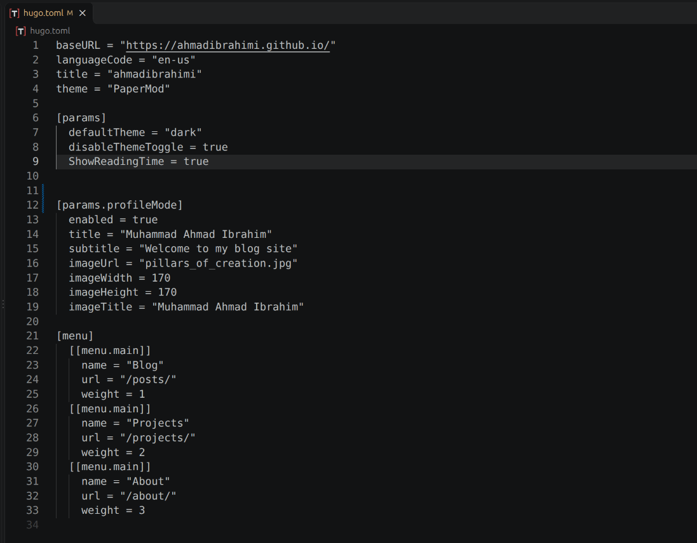

## Step 5: Write your first post

Create a post with Hugo's command:

```bash
hugo new content posts/my-first-post.md
```

Open the new file `content/posts/my-first-post.md`. Hugo has already added the top section, called **front matter**:

```toml
+++
date = '2026-11-18T12:00:00+05:00'
draft = true
title = 'My First Post'
+++
```

Below the closing `+++`, write your post in Markdown:

```markdown
Hello! This is my first post on my new Hugo blog.

## What I learned

- How to install Hugo
- How to add a theme
- How to write a post
```

Two details to know:

- **`draft = true`** means Hugo hides the post when it builds the final site. Change it to `false` when you want it published.
- Posts with a **future date** are also hidden. If you set the date to later today, your post may not show until that time passes.

📸 *Screenshot: the new post file with its front matter in VS Code*

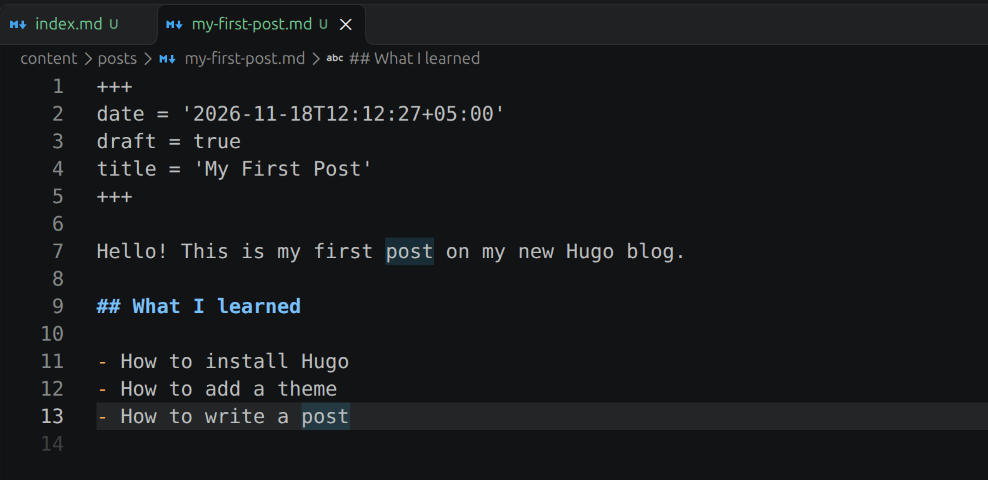

### Add a summary for the post card

On the Posts list, PaperMod shows a short text under each title. Unless you tell it otherwise, it takes the first paragraph of the post. Add a `summary` line to control it:

```toml
+++
date = '2026-11-18T12:00:00+05:00'
draft = false
title = 'My First Post'
summary = 'A short line that appears under the title on the Posts page.'
+++
```

## Step 6: Preview your site

Start Hugo's built-in server:

```bash
hugo server -D
```

Open **http://localhost:1313** in your browser. The `-D` flag also shows drafts, which is useful while writing. Every time you save a file, the page updates by itself. Stop the server with `Ctrl + C`.

Click **Blog** in the menu and you should see your first post.

📸 *Screenshot: the terminal running hugo server, and the site open at localhost:1313*

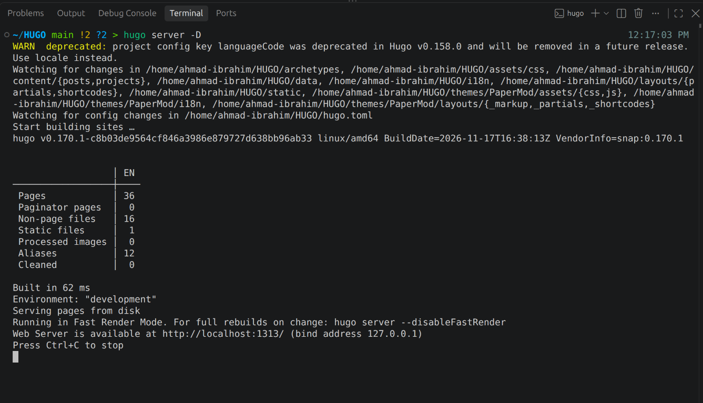

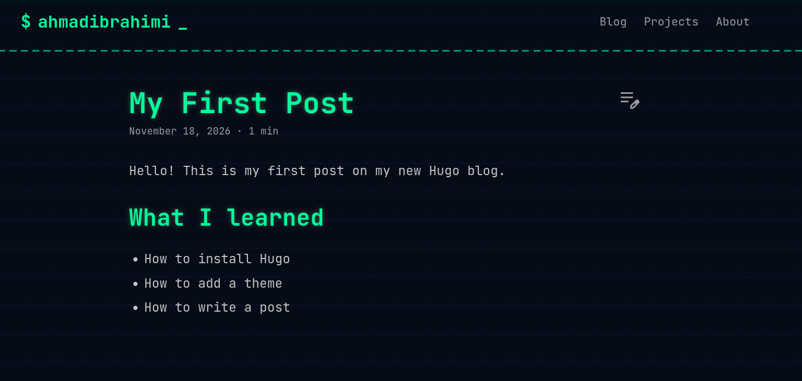

>these pictures are taken after the customization was done, your site will have the default papermod stylings

## Posts with images: use a folder

If a post has pictures, make a folder for it instead of a single file. This is called a **page bundle**:

```
content/posts/my-first-post/
├── index.md
└── screenshot.png
```

Create it with `hugo new content posts/my-first-post/index.md`, and show the image with:

```markdown

```

Keeping images beside the text means they travel with the post. Use `static/` only for site-wide files such as your profile picture.

📸 *Screenshot: a post folder with index.md and its images*

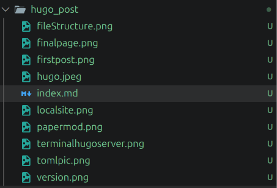

## Customising PaperMod

### The golden rule: do not edit the theme

It is tempting to open `themes/PaperMod` and change files there. Do not do that. When you update the theme, your changes will be overwritten or will cause conflicts.

Instead, Hugo lets your own files **override** the theme's. Anything you put in your project's `layouts/` or `assets/` folder wins over the same file in the theme.

### 1. A home page with your picture (Profile Mode)

PaperMod can show a round picture with a greeting in the centre of the home page. Put your photo in `static/` (for example `dp.jpg`), then add this inside the `[params]` section of `hugo.toml`:

```toml
  [params.profileMode]
    enabled = true
    title = "Hi, I'm Your Name"
    subtitle = "Welcome to my blog and portfolio."
    imageUrl = "dp.jpg"
    imageWidth = 160
    imageHeight = 160
    imageTitle = "Your Name"
```

Keep the width and height equal so the circle stays round. If you prefer a text-only intro, use `[params.homeInfoParams]` with `Title` and `Content` instead.

📸 *Screenshot: the home page with Profile Mode turned on*


### 2. Your own CSS

PaperMod automatically loads any CSS files placed in `assets/css/extended/`. Create `assets/css/extended/custom.css` and it is picked up with no extra setup.

Here is a small example that changes the accent colour and adds a green line across the top:

```css
:root, .dark {
  --green: #00ff9c;
  --theme: #050b17;      /* page background */
  --entry: #081428;      /* post card background */
  --primary: #d7ffee;    /* main text */
  --secondary: #7fa6c9;  /* secondary text */
}

h1, h2, h3 {
  color: var(--green);
}

body::before {
  content: "";
  position: fixed;
  top: 0; left: 0; right: 0;
  height: 3px;
  background: var(--green);
  z-index: 9999;
}
```

PaperMod defines its colours as CSS variables like `--theme`, `--entry` and `--primary`. Changing the variable changes the colour everywhere that uses it, so you rarely need to hunt for individual elements.

Save and look at the browser. If nothing changes, do a hard refresh with `Ctrl + Shift + R`.

### 3. Find the right CSS with Inspect

When a style does not apply, something else is overriding it. On my site, the home page lost its background grid because the theme has this rule for list pages:

```css
[data-theme="dark"] .list { background: var(--theme); }
```

I found it by right-clicking the page, choosing **Inspect**, and reading the **Styles** panel. It shows every rule that touches the element, and the ones that lost are crossed out. Once you know which rule wins, you write a more specific rule of your own in `custom.css`.

📸 *Screenshot: the Inspect panel with a crossed-out rule*

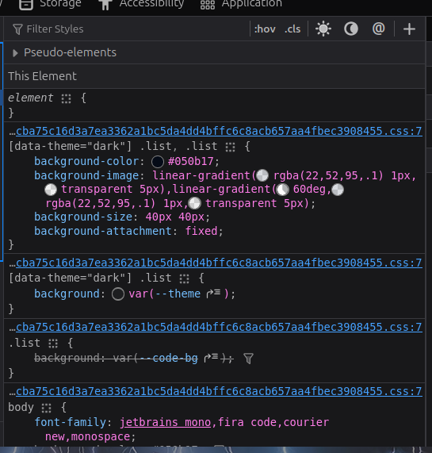

### 4. A different font

Setting `font-family` in CSS only works for visitors if their computer has that font. To load one from Google Fonts for everyone, create the file `layouts/partials/extend_head.html`. PaperMod includes it inside the page's `<head>`:

```html
<link rel="preconnect" href="https://fonts.googleapis.com">
<link rel="preconnect" href="https://fonts.gstatic.com" crossorigin>
<link href="https://fonts.googleapis.com/css2?family=JetBrains+Mono:wght@400;700&display=swap" rel="stylesheet">
```

Then use it in `custom.css`:

```css
body {
  font-family: 'JetBrains Mono', monospace;
}
```

### 5. Menu, table of contents and cover images

- **Menu:** edit the `[[menu.main]]` blocks in `hugo.toml`.
- **Table of contents:** add `ShowToc = true` and `TocOpen = false` to a post's front matter (above any `[cover]` block). It builds itself from your headings and starts collapsed.
- **Cover image:** add a block at the end of the front matter:

```toml
[cover]
  image = "cover.png"
  alt = "Describe the image"
  relative = true
```

`relative = true` is needed when the image sits in the post's own folder.

📸 *Screenshot: the collapsed table of contents, and a post card with a cover image*

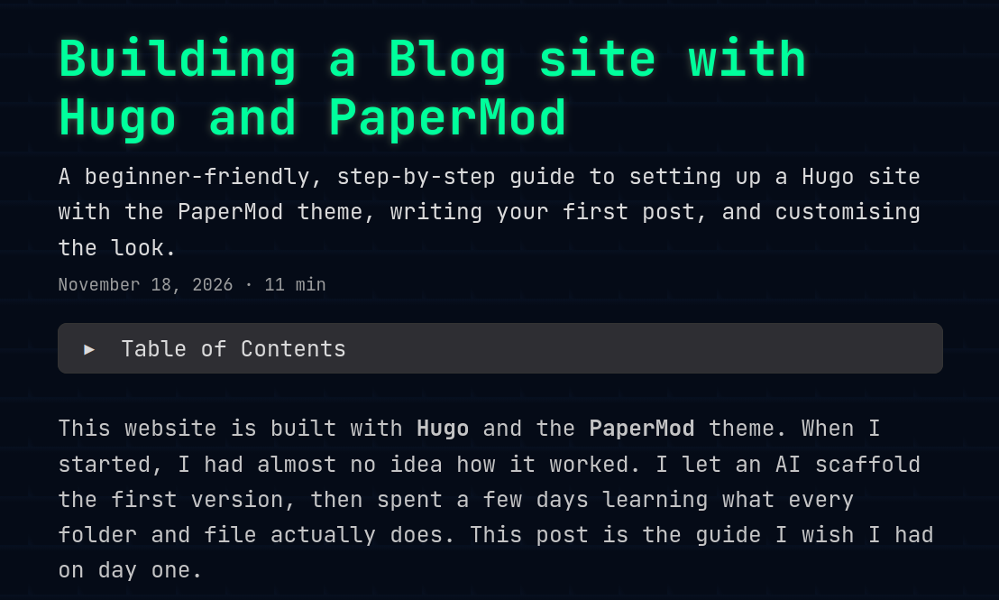

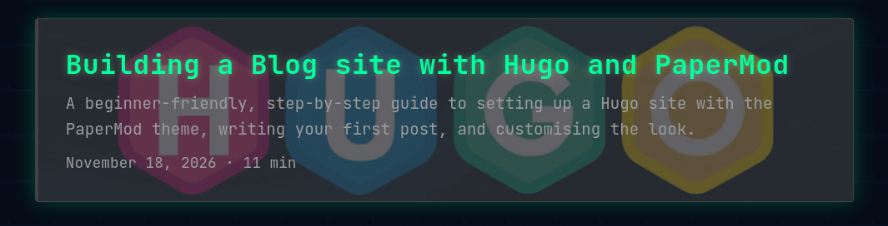

### 6. Shortcodes and layout overrides

Once you are comfortable, you can add your own small templates. A file in `layouts/shortcodes/` becomes a reusable block you can place inside posts, which is how I built the icon buttons on my About page. And to change a theme template, copy it from `themes/PaperMod/layouts/` into the same path under your own `layouts/` folder and edit your copy.

📸 *Screenshot: the About page icon buttons built with a shortcode*

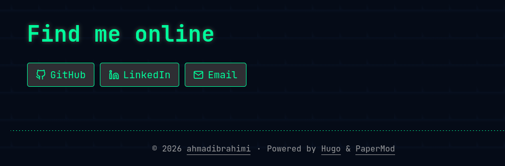

## Publish it with GitHub Pages

1. Create a repository on GitHub named `YOUR-USERNAME.github.io`.
2. Add a `.gitignore` file containing these two lines, so generated files are not committed:

   ```
   public/
   .hugo_build.lock
   ```

3. Commit and push:

   ```bash
   git add .
   git commit -m "First version of my blog"
   git branch -M main
   git remote add origin https://github.com/YOUR-USERNAME/YOUR-USERNAME.github.io.git
   git push -u origin main
   ```

4. On GitHub, go to **Settings, then Pages**, and set **Source** to **GitHub Actions**.
5. Add a deploy workflow. Hugo's documentation has a ready-made one on its "Host on GitHub Pages" page. Save it as `.github/workflows/hugo.yml`, set its Hugo version to match the output of `hugo version` on your machine, and make sure its checkout step uses `submodules: recursive`. Without that setting, the theme is not downloaded and the build produces an empty or broken site.

Each time you push, GitHub rebuilds the site. Give it a minute or two, then hard refresh. If something looks stale, open the **Actions** tab on your repository to see whether the build passed.

My routine for every update is:

```bash
git add .
git commit -m "describe what changed"
git push
```

## Common problems and fixes

- **The site is blank or has no styling:** the `theme` name in `hugo.toml` does not match the folder in `themes/`, or the theme was not downloaded. Run `git submodule update --init --recursive`.
- **My post does not appear:** it is probably a draft (`draft = true`) or has a future date. Use `hugo server -D` locally, and set `draft = false` before publishing.
- **My images are broken:** the post must be a folder with an `index.md`, the image must be in that same folder, and the filename must match exactly, including capital letters.
- **The post card shows the first paragraph, not my subtitle:** add a `summary` line to the front matter.
- **My CSS change does nothing:** hard refresh, and use Inspect to check whether another rule is winning.
- **It works on my computer but not online:** check that the build in the Actions tab passed, and that `baseURL` is correct.

## What's next

That is the complete path from nothing to a live blog: install Hugo, add PaperMod, write a post, make it your own, and publish it. The best way to learn from here is to change one small thing at a time, watch the preview update, and use Inspect when something surprises you.

If you get stuck on any step, reach out to me on [LinkedIn](https://www.linkedin.com/in/ahmad-ibrahim-360a7a28b).
